<div align="center">


# Forma

**为 Linux 打造的原生桌面应用，探索 macOS 26 风格的清晰与轻盈。**

C++20 · SDL3 · Vulkan / OpenGL · 简体中文 · Arch Linux

[应用预览](#应用预览) · [构建运行](#构建运行) · [Arch Linux 安装](#arch-linux-安装) · [桌面门户](#forma-桌面门户开发中) · [框架文档](docs/framework.md)

</div>

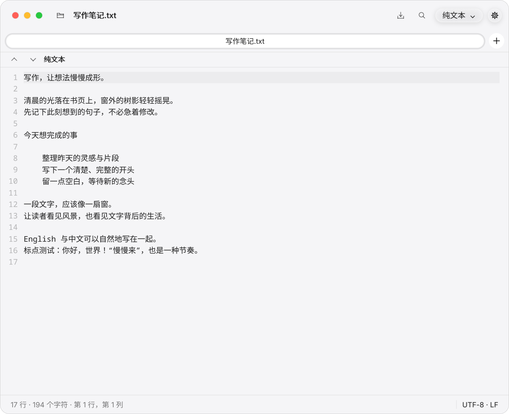

Forma 基于 [Mayonnaise](https://github.com/egely1337/mayonnaise) UI 框架，提供文件管理、终端、邮件、文本编辑等桌面应用。窗口、控件和文字由框架自行绘制，以连续圆角、半透明材质和细腻层次构成统一的视觉语言；核心应用无需 GTK、Qt 或 Electron；桌面门户集成保留 KDE / Qt 后端，独立文件选择器也使用 Qt6 Core 处理 JSON、MIME 和 URL。

当前重点是 Linux 上的中文使用体验、可实际工作的应用流程，以及统一的 Forma 家族图标。项目仍在开发中，界面接近 macOS 的设计语言，尚非像素级一致复刻。

## 应用预览

下列截图由本仓库应用实际启动渲染，使用临时配置与示例数据。邮件截图为离线示例；系统设置截图在只读模式下拍摄。

### 文本编辑器

多行 UTF-8 编辑、选区与剪贴板、撤销重做、打开与保存、未保存保护、查找替换、行号、自动换行、SVG 高亮和明暗外观。界面及动态状态信息使用简体中文，正文和文件名保持原文。

| 浅色 | 深色 |
| --- | --- |
|  | 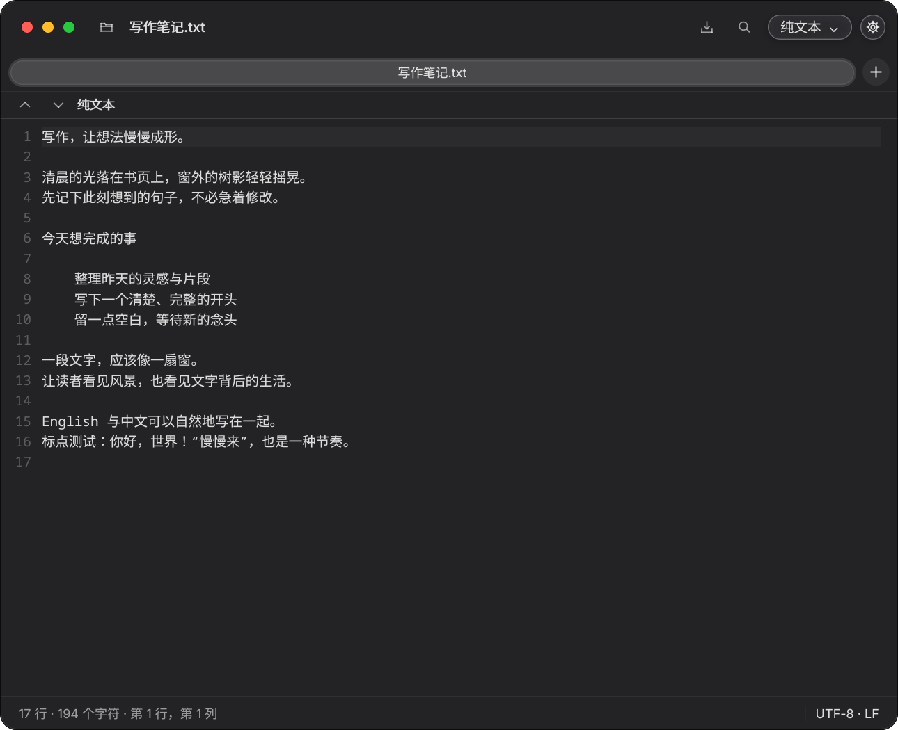 |

[查找与替换预览](docs/screenshots/forma-editor-find.png) · [详细说明](applications/text_editor/README.md)

### 文件管理器与终端

文件管理器提供图标、列表、分栏视图，以及预览、搜索、文件操作和应用打开方式。终端提供 PTY、标签页、选择复制、配色方案及中文字体回退。

文件管理器的“打开方式”支持勾选“始终以此方式打开”，将默认应用保存到 `$XDG_CONFIG_HOME/mimeapps.list`（默认 `~/.config/mimeapps.list`），重启后仍然生效，也可覆盖 KDE 的系统默认应用。选择应用后关闭打开方式面板，文件管理器窗口继续保留；保存或启动失败时显示错误提示。AppImage 缺少执行权限时会提示添加权限后打开，属性面板也可切换“允许作为程序执行”，并同步显示权限位。

| Forma 文件管理器 | Forma 终端 |
| --- | --- |
| 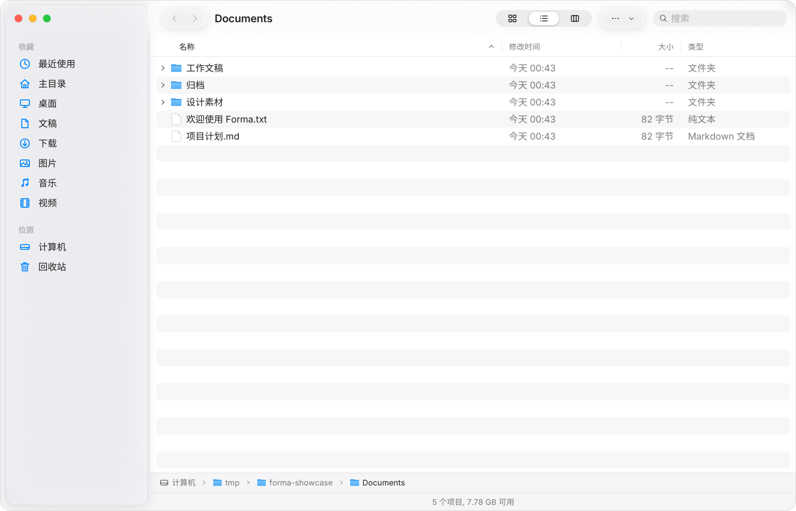 | 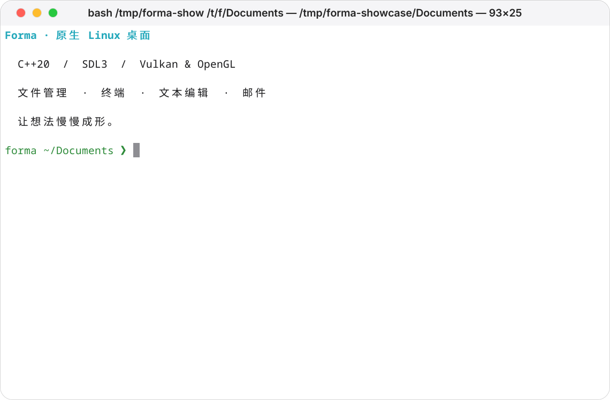 |

### 邮件与系统设置

邮件支持 IMAP / SMTP、中文 MIME、附件和本地草稿。系统设置连接 Linux 桌面服务，覆盖 GNOME 与 KDE 的部分设置面板。

| Forma 邮件 | Forma 系统设置 |
| --- | --- |
| 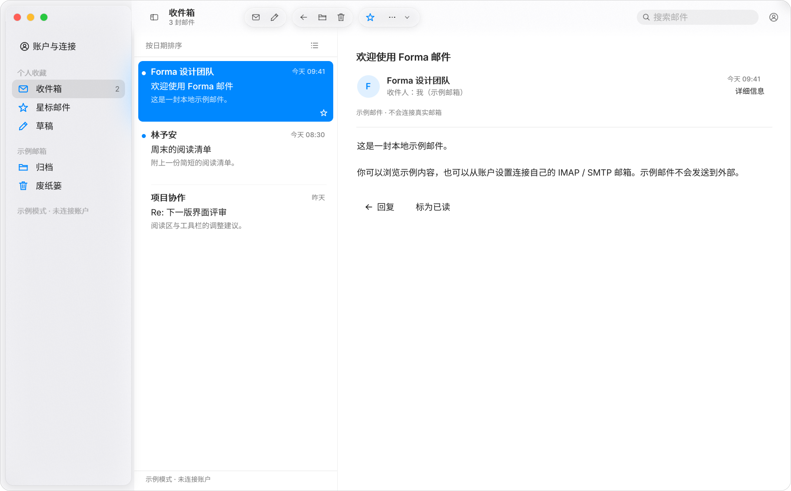 | 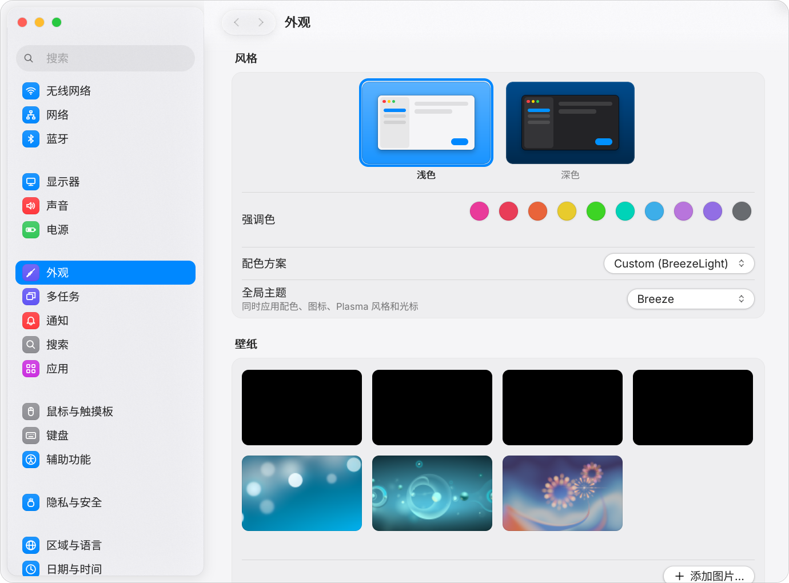 |

邮件目前是候选版：Google / Microsoft OAuth 应用注册与真实服务商验收尚未完成。请阅读 [邮件说明](applications/mail/README.md) 和 [OAuth 配置说明](applications/mail/OAUTH_SETUP.md)。系统设置的实际能力取决于当前桌面及已安装服务。

### 应用商店

Forma 应用商店面向 Flatpak，提供浮动玻璃侧边栏、今日应用横幅、编辑精选卡片、应用网格与详情页。侧边栏、网格卡片文字与操作按钮复用 Forma 框架的 `Sidebar`、`Label` 和 `Button`；网格卡片图标统一为 64×64 逻辑像素并保持原始比例，文字自动省略，编辑精选区在窄窗口切换为单列。目录来自本机 AppStream 缓存，可离线浏览 3000+ 个应用；安装与更新通过 flatpak 执行并显示实时进度。

| 精选 | 应用详情 |
| --- | --- |
| 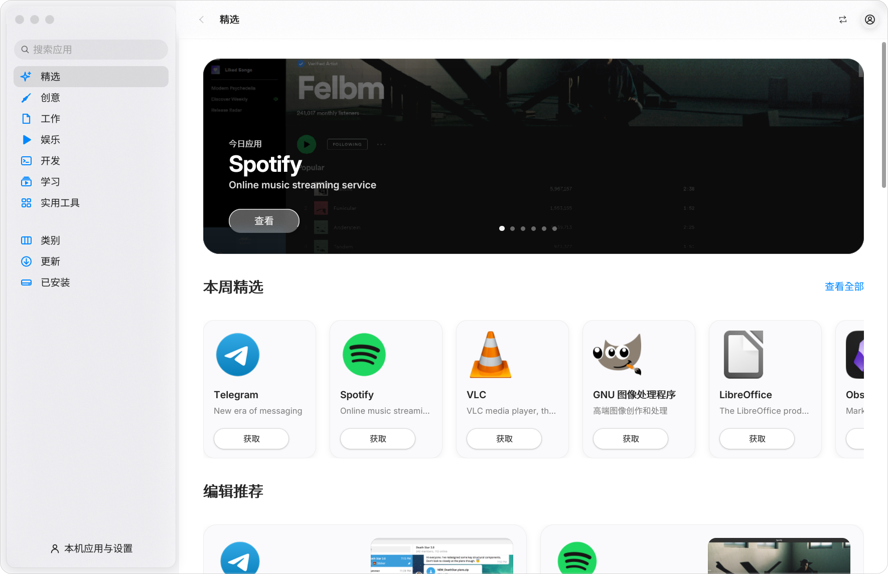 |  |

[应用商店说明](applications/app_store/README.md)

Arch Linux 用户可在本地构建并安装当前版本（`0.1.0-2`）：

```sh
(cd packaging/arch-appstore && makepkg -sif)
forma-app-store
```

升级后请关闭旧窗口，再重新启动应用商店。

### 任务管理器与照片

任务管理器显示进程及系统资源；照片应用支持图片导入、缩略图浏览和查看。

| Forma 任务管理器 | Forma 照片 |
| --- | --- |
| 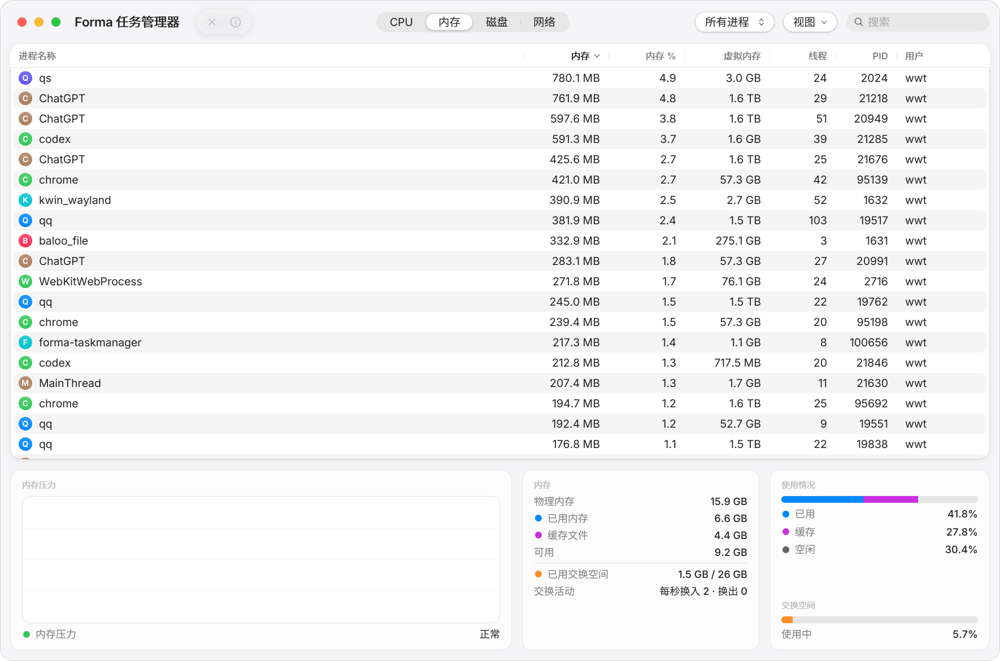 | 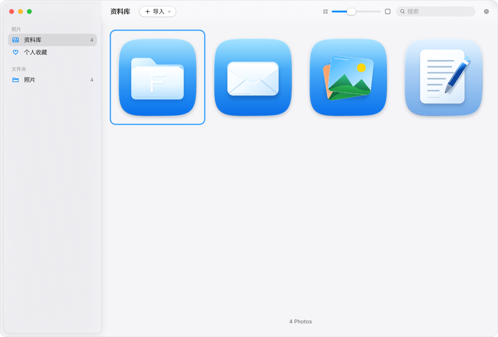 |

仓库还包含视频播放器、音乐播放器和计算器，沿用同一套 UI 框架。

## 构建运行

需要 C++20 编译器、CMake ≥ 3.21、SDL3、FreeType，以及 OpenGL 开发文件。默认启用 Vulkan 后端，所需工具由 CMake 检查；可用 `-DMAYONNAISE_VULKAN=OFF` 关闭。

核心应用在 Arch Linux 上的开发依赖（门户后端的 KDE / Qt 依赖由其 PKGBUILD 单独声明）：

```sh
sudo pacman -S --needed base-devel cmake pkgconf sdl3 freetype2 fontconfig \
  libglvnd vulkan-headers shaderc glib2 ffmpeg curl libsecret json-glib doctest
```

```sh
cmake -S . -B build -DCMAKE_BUILD_TYPE=Release \
  -DMAYONNAISE_USE_SYSTEM_DEPS=ON -DMAYONNAISE_BUILD_TESTS=ON
cmake --build build -j4
ctest --test-dir build --output-on-failure
```

应用商店需要 libcurl 与 flatpak；邮件应用需要 libcurl、libsecret 和 json-glib；音视频应用需要 FFmpeg；系统设置需要 GIO。字体跟随系统回退，中文推荐安装 `noto-fonts-cjk`。

| 应用 | 运行命令 |
| --- | --- |
| 文本编辑器 | `./build/applications/text_editor/texteditor` |
| 文件管理器 | `./build/applications/finder/finder` |
| 终端 | `./build/applications/terminal/forma-terminal` |
| 邮件 | `./build/applications/mail/forma-mail` |
| 系统设置 | `./build/applications/system_settings/forma-settings` |
| 任务管理器 | `./build/applications/task_manager/forma-taskmanager` |
| 照片 | `./build/applications/photos/photos` |
| 视频播放器 | `./build/applications/video_player/video_player` |
| 音乐播放器 | `./build/applications/music/music` |
| 计算器 | `./build/applications/calculator/calculator` |
| 应用商店 | `./build/applications/app_store/forma-app-store` |

应用配置默认保存在 `~/.config/mayonnaise/` 对应子目录。可通过 `XDG_CONFIG_HOME` 使用独立配置。

## Arch Linux 安装

每个配方从当前本地源码构建，包含尚未提交的修改。先克隆整个仓库，再进入相应打包目录：

```sh
git clone --branch master https://github.com/skjsbsnq/Forma.git
cd Forma/packaging/arch-texteditor
makepkg -si
```

| 打包目录 | 应用 |
| --- | --- |
| `packaging/arch-texteditor` | 文本编辑器 |
| `packaging/arch-portal` | Forma 桌面门户（替换官方 KDE 门户包） |
| `packaging/arch-finder` | 文件管理器 |
| `packaging/arch-mail` | 邮件 |
| `packaging/arch-taskmanager` | 任务管理器 |
| `packaging/arch-suite` | 终端、系统设置 |
| `packaging/arch-media` | 照片、视频播放器 |
| `packaging/arch-appstore` | 应用商店 |

更新文件管理器（当前打包版本 `0.1.0-12`）可在仓库根目录执行；`-f` 会重新构建已有的同版本安装包：

```sh
git pull --ff-only origin master
(cd packaging/arch-finder && makepkg -sif)
```

安装完成后关闭旧文件管理器窗口并重新启动。文件管理器回归测试覆盖默认应用跨进程持久化、KDE 系统默认覆盖、打开方式点击交互、失败提示，以及 AppImage 授权与启动：

```sh
cmake --build build --target finder_open_tests -j4
ctest --test-dir build -R finder_open_tests --output-on-failure
```

源码仓库不保存构建目录或 `.pkg.tar.zst` 安装包。安装包可在本机构建；这些配方尚未发布到 AUR。`packaging/arch` 保留上游 Mayonnaise 的 Git 分包方案，与 Forma 本地源码配方不同。

## Forma 桌面门户（开发中）

基于固定版本 KDE `v6.8.0`，统一文件选择、打开方式、授权、截图、屏幕共享、打印等门户窗口的 Forma 外观。独立文件窗口复用 Forma 文件管理器组件；其他窗口保留 KDE 的数据绑定和功能实现，接入私有 Qt Quick / Widgets 样式。

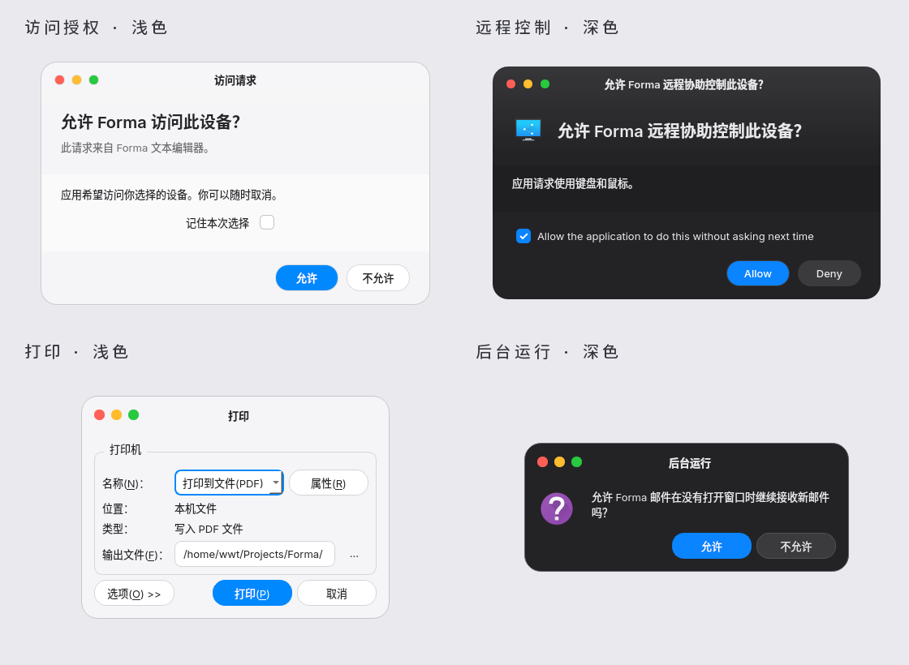

| 文件选择器浅色 | 文件选择器深色 |
| --- | --- |
| 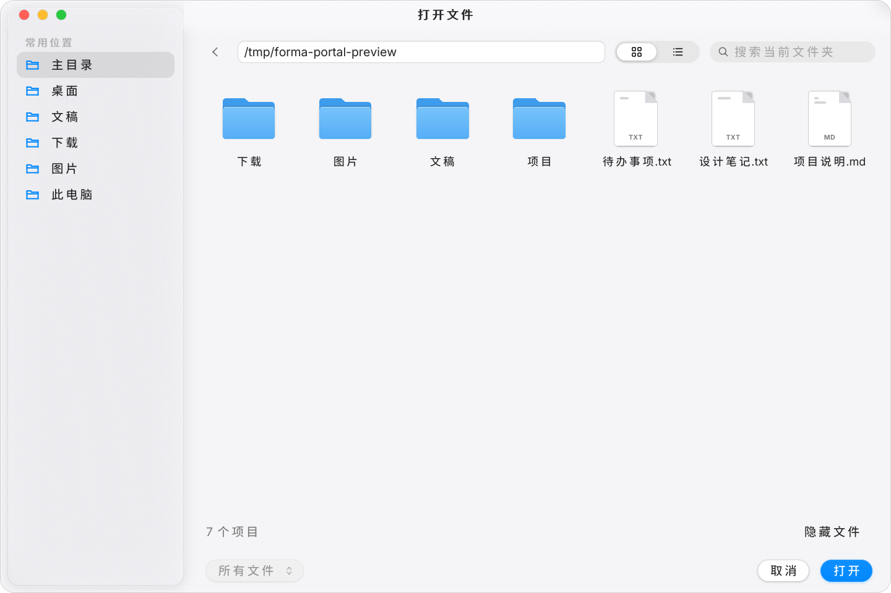 | 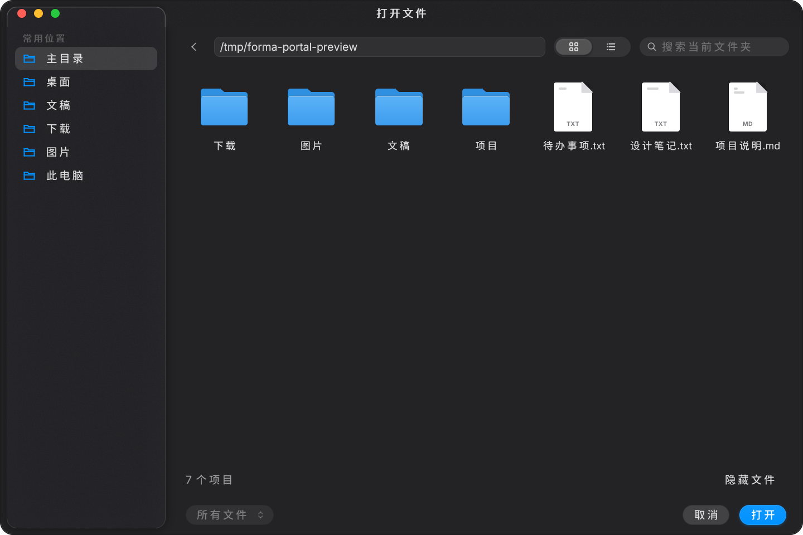 |

在仓库根目录构建 Arch 安装包：

```sh
git submodule update --init integrations/xdg-desktop-portal-kde
(cd packaging/arch-portal && makepkg -s)
```

构建命令不会安装门户包。安装并切换服务：

```sh
sudo pacman -U packaging/arch-portal/xdg-desktop-portal-forma-6.8.0-1-x86_64.pkg.tar.zst
systemctl --user daemon-reload
systemctl --user restart plasma-xdg-desktop-portal-kde.service xdg-desktop-portal.service
```

该包替换官方 `xdg-desktop-portal-kde`，保留 KDE 后端接口，并配置独立 Forma 文件选择器。安装、恢复官方包及日志命令见 [Arch 门户安装说明](packaging/arch-portal/README.md)。

无需切换当前门户服务即可预览：

```sh
./build/applications/portal/forma-file-picker --preview
./build-portal-kde/bin/forma-portal-preview AppChooserDialog
```

上述预览程序需先按 [构建与试用](integrations/kde/README.md) 编译。当前已通过 28 项明暗组件渲染与取消检查；常规 CTest 的 3 项测试也全部通过。跨进程父窗口绑定、Wayland 激活和严格模态仍需完善，真实录屏、远程控制、USB 和打印流程仍需会话及设备验收。完整范围见 [界面覆盖与边界](integrations/kde/STYLE_COVERAGE.md)。

## UI 框架与开发

框架使用保留式组件树，自行渲染窗口装饰、玻璃材质、阴影和文字，支持主题、弹簧动画及高 DPI。公共 API 不暴露 SDL、OpenGL 或 FreeType 类型。

```cpp
#include <mayonnaise/mayonnaise.hpp>

int main() {
    mayo::App app("hello-forma");
    auto& window = app.createWindow({.title = "你好，Forma", .width = 640, .height = 420});
    window.setContent(mayo::VStack({
        mayo::Label("让想法慢慢成形。"),
        mayo::Button("开始")
    }).spacing(16).padding(24));
    return app.run();
}
```

- [框架 API、架构与原始示例文档](docs/framework.md)
- [文本编辑器实现、本地化与视觉验证](applications/text_editor/README.md)
- [邮件协议、缓存和测试说明](applications/mail/README.md)
- [图标生成器](tools/make_forma_icons.py)：运行 `python tools/make_forma_icons.py text_editor` 只更新文本编辑器图标。

可重复截图：

```sh
MAYO_DEMO=chinese MAYO_APPEARANCE=light \
  XDG_CONFIG_HOME=/tmp/forma-preview \
  MAYO_SCREENSHOT=/tmp/forma-editor.png \
  ./build/applications/text_editor/texteditor
```

`MAYO_APPEARANCE=dark` 切换深色；`MAYO_SCALE=2` 验证高 DPI。截图模式会在保存首个窗口截图后退出。辅助窗口可使用 `MAYO_SCREENSHOT_WINDOW=last`。

## 致谢与许可证

Forma 在 [egely1337/mayonnaise](https://github.com/egely1337/mayonnaise) 的基础上继续开发，保留上游历史与版权声明。代码采用 [GPL-3.0](LICENSE.txt)，Inter 字体采用 [SIL Open Font License](assets/fonts/Inter-LICENSE.txt)。

Forma 家族 SVG 图标由项目自行绘制，不随项目分发 Apple 图标、系统字体或参考截图。
