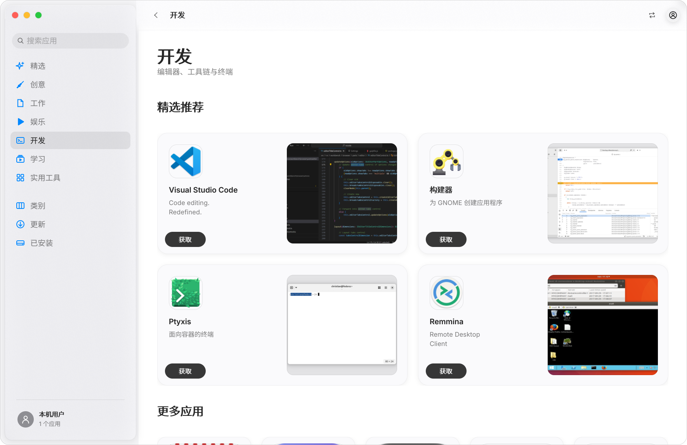
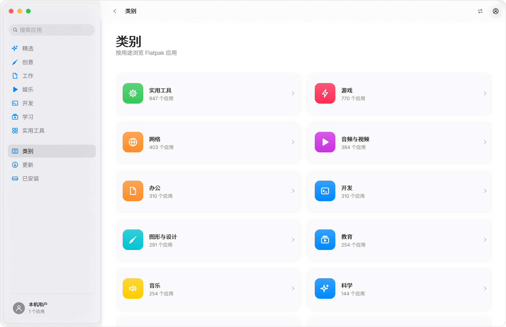
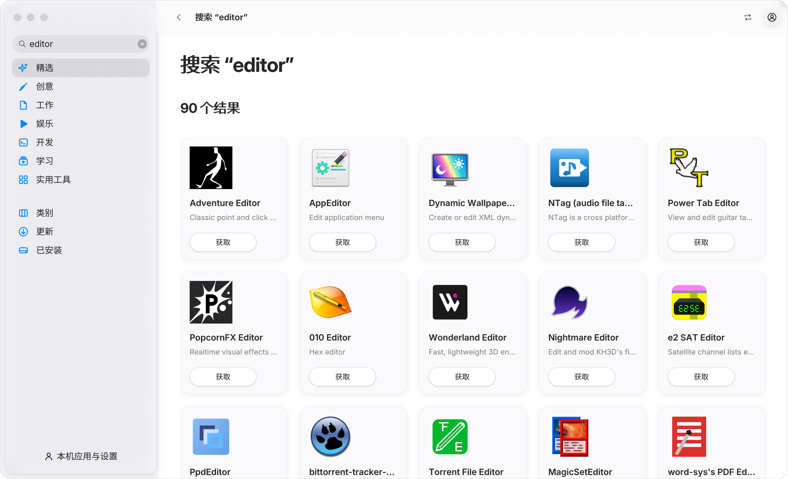
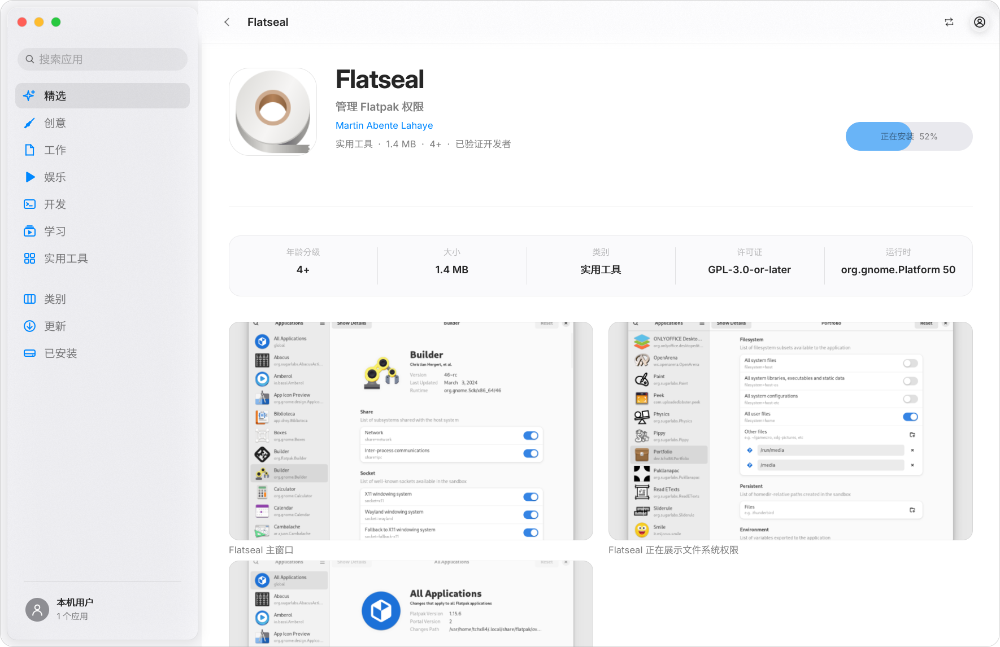
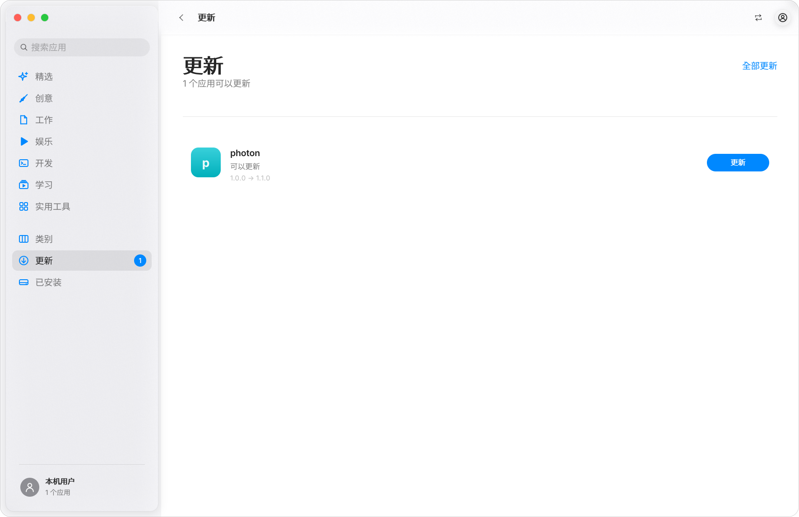
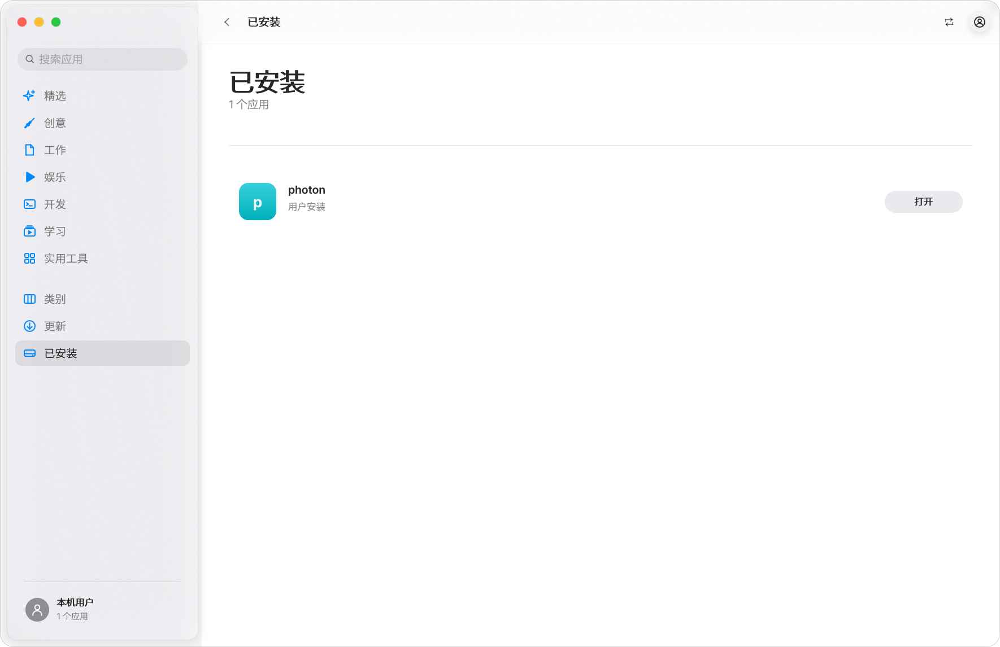
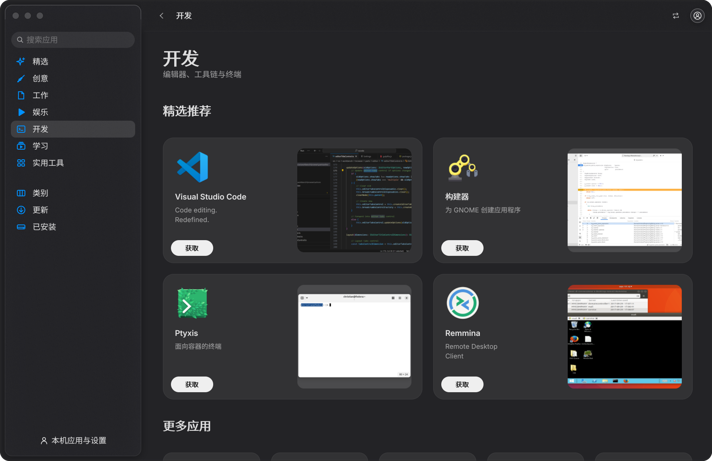

# Forma 应用商店

面向 Flatpak 的桌面应用商店，界面以 macOS 26 Tahoe 的 App Store 为视觉基准：浮动玻璃侧边栏、统一工具栏、圆角应用卡片、编辑精选横幅与详情页。应用完全由 Forma（Mayonnaise）框架自行绘制，不依赖 GTK、Qt 或 WebView。


## 运行

```sh
./build/applications/app_store/forma-app-store
```

需要 `flatpak` 与至少一个已配置的远程仓库（通常是 Flathub）。应用启动时读取本机 AppStream 缓存，因此目录、图标和详情都能离线浏览；安装、更新与卸载会调用 `flatpak` 并显示实时进度。

```sh
# 首次使用，确保 Flathub 已添加并生成了元数据
flatpak remote-add --if-not-exists flathub https://dl.flathub.org/repo/flathub.flatpakrepo
flatpak remote-ls --app >/dev/null   # 生成 /var/lib/flatpak/appstream 缓存
```

## 界面

| 精选 | 开发 |
| --- | --- |
|  |  |

| 类别 | 搜索 |
| --- | --- |
|  |  |

| 应用详情 | 安装进度 |
| --- | --- |
|  |  |

| 更新 | 已安装 |
| --- | --- |
|  |  |

深色外观：



### 与 macOS 26 App Store 的对应关系

| macOS 26 App Store | Forma 应用商店 |
| --- | --- |
| 浮动玻璃侧边栏 + 交通灯 | `SplitView` 玻璃面板与框架 `Sidebar`，顶部是搜索框 |
| Discover / Create / Work / Play / Develop / Learn / Updates | 精选 / 创意 / 工作 / 娱乐 / 开发 / 学习 + 类别、更新、已安装 |
| 今日应用横幅、编辑推荐卡片 | 截图背景的 Hero 横幅、双列精选卡片、图标卡片横排 |
| 统一工具栏、玻璃胶囊按钮 | `Toolbar` + `ToolbarGroup`、`ButtonStyle::Glass` |
| 应用页：图标、评分信息条、截图、版本说明 | 图标头部、信息网格、截图画廊、版本说明 |
| 黑色「获取」/「打开」胶囊 | 框架卡片按钮与精选胶囊：获取、安装进度、打开、更新、重试 |

### 布局与框架组件

侧边栏复用 Forma `Sidebar`（选择动画、滚动与键盘导航），应用网格卡片的文字和操作复用 `Label`、`Button`，底部设置入口使用框架按钮。Hero、精选图片与卡片背景保留定制绘制。

应用卡片使用固定 64×64 逻辑像素图标并保持图片比例，卡片高度不随列宽放大；名称与摘要单行省略，操作按钮单独排列。编辑精选区在内容宽度不足 700 逻辑像素时切换为单列。

## 功能

- **目录**：解析 Flatpak 的 AppStream XML（约 3000+ 个应用），支持本地缓存的 128×128 图标，远端图标与截图按需下载并缓存到 `~/.cache/mayonnaise/app_store`。
- **编辑分区**：创意 / 工作 / 娱乐 / 开发 / 学习 / 实用工具，每个分区先展示带截图的精选卡片，再展示网格。
- **类别**：按 AppStream 类别浏览，显示应用数量。
- **搜索**：名称、ID、摘要、开发者、关键字、类别匹配，按相关度排序，中英文均可。
- **已安装 / 更新**：列出本机 Flatpak 应用与可用更新，`flatpak remote-ls --updates` 给出权威结果；更新页支持全部更新。
- **安装流程**：`flatpak install` / `update` / `uninstall` 在后台线程运行，进度解析成百分比并绘制在卡片胶囊上；失败时在页面底部显示可关闭的错误条。
- **界面细节**：跟随系统浅色/深色与强调色，高 DPI（`MAYO_SCALE=2`），返回历史（⌥←），Ctrl+R 刷新，Ctrl+F 搜索。

## 快捷键

| 快捷键 | 功能 |
| --- | --- |
| `Ctrl+F` | 聚焦搜索框 |
| `Ctrl+R` | 重新载入 AppStream 目录 |
| `Ctrl+,` | 设置页 |
| `⌥←` | 返回上一页 |

## 截图复现

截图使用临时配置目录和 `MAYO_DEMO` 驱动，不会写入真实设置：

```sh
XDG_CONFIG_HOME=/tmp/forma-store MAYO_DEMO=discover \
  MAYO_SCREENSHOT=/tmp/store.png MAYO_SCREENSHOT_DELAY=9 \
  ./build/applications/app_store/forma-app-store
```

`MAYO_DEMO` 接受逗号分隔的步骤：`discover`、`create`、`work`、`play`、`develop`、`learn`、`utilities`、`categories`、`updates`、`installed`、`settings`、`search:<文本>`、`app:<应用 ID>`、`category:<类别>`，以及仅用于演示的 `simupdate`（模拟有可用更新，不修改系统）。

## 代码结构

```
applications/app_store/
  main.cpp       应用入口、工具栏、页面路由、安装作业与错误提示
  store_ui.cpp   页面组合：框架侧边栏、文字与按钮，定制 Hero、图片与响应式网格
  catalog.cpp    AppStream 解析、flatpak 调用、搜索、分类与文案
  images.cpp     图标/截图的后台下载与缓存
  json_lite.cpp  flatpak --json 输出的小型 JSON 读取器
  tests/         目录解析、搜索、JSON 与真实缓存的单元测试
```

`catalog.cpp` 不依赖 UI，可在无显示环境下测试：

```sh
ctest --test-dir build -R forma_store_tests --output-on-failure
```

## 依赖与打包

构建需要 libcurl（`pkg-config --modversion libcurl`），运行需要 `flatpak`。安装：

```sh
cmake --build build --target forma-app-store
sudo cmake --install build --component forma-app-store
```

Arch Linux 当前打包版本为 `0.1.0-2`，在仓库根目录执行：

```sh
(cd packaging/arch-appstore && makepkg -sif)
forma-app-store
```

如已构建安装包，也可直接安装或升级：

```sh
sudo pacman -U packaging/arch-appstore/forma-appstore-0.1.0-2-x86_64.pkg.tar.zst
```

升级后关闭旧窗口并重新启动。安装包在本地生成，不随源码仓库分发。

`.desktop` 与 SVG 图标位于 `applications/app_store/data/`，图标由 `tools/make_forma_icons.py app_store` 生成。

## 已知限制

- 仅支持 Flatpak；不处理发行版原生包、Snap 或 AppImage。
- 评分、评论与账户体系未接入（AppStream 不提供这些数据）。
- 安装需要 polkit 授权时，授权对话框由系统弹出，进度会等待授权完成。
- 截图与远端图标需要网络；离线时显示渐变色占位图标。
- 卸载入口已实现但界面只在应用页保留接口，避免误操作。
