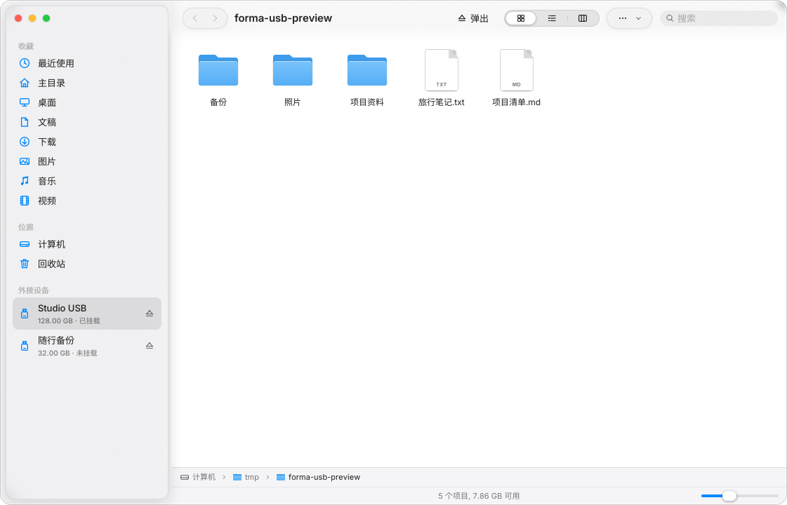
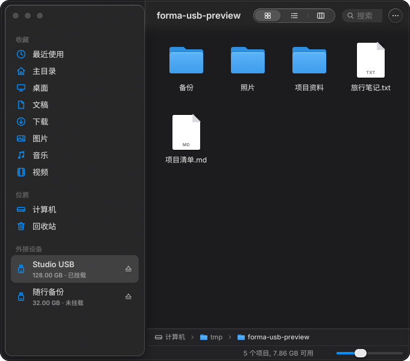
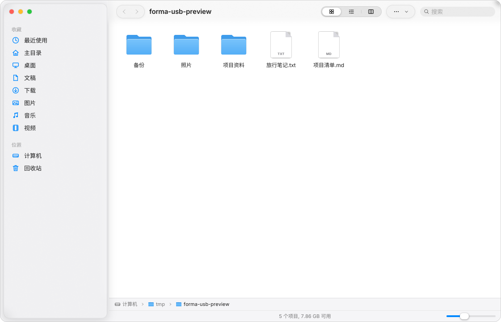

# Finder 存储设备

Finder 通过系统总线连接 UDisks2，后台每 2 秒刷新设备列表。它使用 UDisks 的设备属性识别 USB / 可移动介质，不再仅靠 `/media` 路径猜测设备类型。原有 `/mnt` 等挂载目录仍作为位置显示。

- 插入 U 盘：在「外接设备」中显示名称、容量和挂载状态；点击未挂载设备会挂载并打开，已挂载设备直接打开。
- 没有设备时隐藏整个分组，不显示「尚未连接设备」占位行。连接时使用与收藏栏一致的蓝色线条图标，不再使用绿色底块；磁盘服务错误显示在底部状态栏。
- 安全弹出：点击侧栏右侧弹出图标，或在设备目录中点击工具栏「弹出」/按 `Ctrl+E`。窄窗口工具栏折叠时，也可从操作菜单使用「安全弹出」。
- 先正常卸载同一物理设备及共享 `SiblingId` 的逻辑设备上的全部已挂载文件系统，再调用 `Drive.PowerOff`；不支持断电时使用 `Drive.Eject`，两者均不支持时仅卸载并提示可以拔出。隐藏分区也参与卸载检查，包含系统分区的设备拒绝弹出。
- 文件复制/移动期间禁止弹出。其他程序占用导致卸载失败时保留错误提示并停止后续操作，不发送强制卸载选项。多分区设备可能已有部分分区卸载成功，列表会按实际状态刷新。
- 插拔或外部卸载后自动更新列表；正在浏览的挂载点消失时返回主目录，并清除对应导航历史和剪贴板路径。
- 权限由系统 Polkit 管理。缺少服务、设备占用、授权失败时显示中文提示；系统验证需要桌面的 Polkit agent。加密分区的解锁、格式化、分区编辑不在此功能范围内。

编译依赖 `gio-2.0`（Arch：`glib2`），运行依赖 `udisks2`。Arch 的 `forma-finder` 包已声明两项依赖。服务使用 D-Bus 激活，无需把 Finder 以 root 运行。

## 验证

```sh
cmake -S . -B build -DMAYONNAISE_BUILD_TESTS=ON
cmake --build build --target finder finder_volume_tests finder_open_tests mayonnaise_tests -j4
ctest --test-dir build -R 'finder_(volume|open)_tests|mayonnaise_tests' --output-on-failure
```

`finder_volume_tests` 覆盖 ObjectManager 数据解析、未挂载设备、中文和带空格的挂载点、隐藏/系统分区、共享机箱分区、设备移除、侧栏按钮点击/取消/忙碌状态。它会启动私有 D-Bus 和模拟 UDisks 服务，验证实际 Mount/Unmount/PowerOff 调用顺序，以及卸载失败时绝不继续断电、授权失败和取消操作；不访问真实磁盘。

浅色、深色截图使用模拟设备生成，均未执行真实挂载或弹出。真实 U 盘硬件插拔、实际文件系统挂载以及 Polkit 验证仍需在桌面上验收。

```sh
MAYO_DEMO=devices MAYO_APPEARANCE=light MAYO_SCALE=1 \
  XDG_CONFIG_HOME=/tmp/forma-volume-preview \
  MAYO_SCREENSHOT=/tmp/forma-volumes-light.png \
  ./build/applications/finder/finder /tmp/forma-usb-preview
# MAYO_DEMO=devices,narrow MAYO_APPEARANCE=dark 可验证 680×600 窗口。
```





接口参考：[Filesystem.Mount / Unmount](https://storaged.org/doc/udisks2-api/latest/gdbus-org.freedesktop.UDisks2.Filesystem.html)、[Drive.PowerOff / Eject](https://storaged.org/doc/udisks2-api/latest/gdbus-org.freedesktop.UDisks2.Drive.html)。
