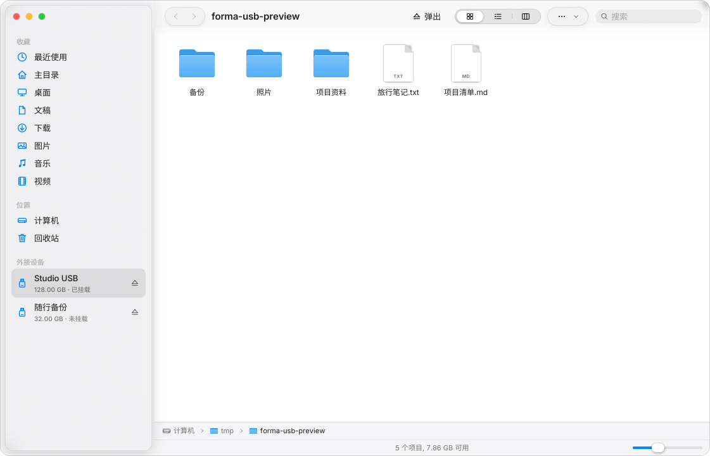
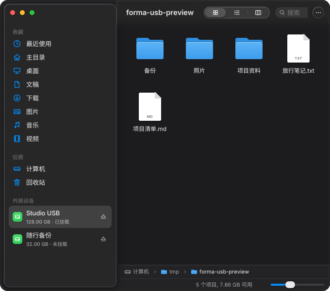
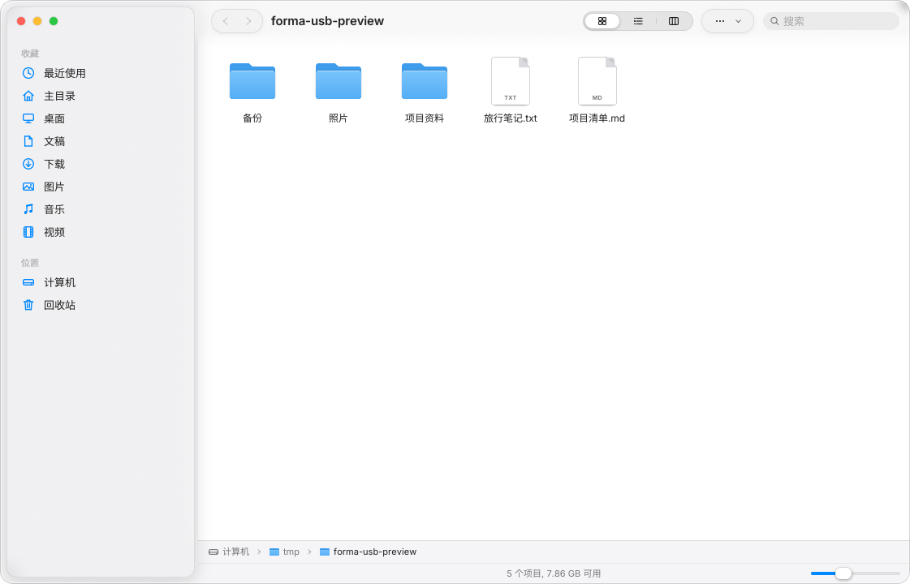

# Forma Finder

## 重命名

右键「重命名」、Enter 和 F2 在文件名处编辑；Enter 保存、Escape 取消，点击其他位置也会保存。菜单关闭时保留编辑框焦点。文件默认选中不含扩展名的部分，文件夹选中完整名称。

属性里的铅笔按钮打开名称编辑框，按 Enter 或点击「重命名」保存。它也支持从空白区域打开属性后修改当前文件夹名称，并更新当前路径。同名或无效名称会显示错误；失败时保留名称编辑框。回收站中的项目禁止重命名。

`finder_open_tests` 包含三种文件视图和属性入口的重命名回归测试，覆盖中文名称、扩展名、保存、取消、失焦提交、文件夹、空名称、路径分隔符及已占用的符号链接名称。完整窗口可用临时目录验证菜单关闭后的输入与提交：

```sh
scratch=$(mktemp -d)
touch "$scratch/原名.txt"
MAYO_DEMO='menu:原名.txt,clickrow:重命名,wait:0.3,key:enter,wait:0.3,input:新名,key:enter' \
  XDG_CONFIG_HOME="$scratch/config" MAYO_SCREENSHOT="$scratch/renamed.png" MAYO_SCREENSHOT_DELAY=3 \
  ./build/applications/finder/finder "$scratch"
test -f "$scratch/新名.txt"
```

## 复制与剪切

右键菜单和快捷键使用文件 URI 列表，并携带复制／剪切标记；切换目录后仍可粘贴，两个窗口之间也保留剪切语义。文件名中的中文、空格、百分号和换行按 URI 编码处理。

Wayland 下，如果桌面剪贴板管理器接管数据后 SDL 无法读回剪贴板，使用 `wl-paste` 读取当前系统内容，避免回退到已失效的旧文件列表。Arch 包声明了 `wl-clipboard` 运行依赖。`finder_open_tests` 覆盖自身剪贴板读取、替换、清空及 URI 格式。

## 压缩包右键菜单

单选或多选文件、文件夹，以及文件和文件夹的混合选择，均可使用「压缩…」。此操作调用 `ark --add --dialog --changetofirstpath`，由 Ark 弹出窗口选择压缩包名称、格式和保存位置；默认位置为首个所选项目的父目录。`--dialog` 必须显式传入，否则 Ark 会直接启动压缩任务并报缺少压缩包名称。搜索或最近使用中选择的项目也可一起压缩。取消 Ark 对话框不创建压缩包，回收站中的项目不显示此操作。

选中 ZIP、RAR、7z、tar 等压缩包后，可直接使用「解压到此处」或「解压到…」。前者解压到压缩包所在目录，后者弹出文件夹选择器；取消选择不执行操作。支持多选压缩包，搜索或最近使用中的压缩包也按各自所在目录解压。

解压调用 `ark --batch --destination`，由 Ark 显示进度、密码、覆盖确认和解压错误。压缩或解压时缺少 Ark 会显示安装提示（Arch：`sudo pacman -S ark`）。普通文件、文件夹、混合选择和回收站中的压缩包不显示这两个解压操作。`finder_open_tests` 覆盖压缩选择条件、格式识别、参数传递、中文与特殊字符文件名、目标目录和缺少 Ark 的情况。

## 存储设备

Finder 通过系统总线连接 UDisks2，后台每 2 秒刷新设备列表。它使用 UDisks 的设备属性识别 USB / 可移动介质，不再仅靠 `/media` 路径猜测设备类型。原有 `/mnt` 等挂载目录仍作为位置显示。

- 插入 U 盘：在「外接设备」中显示名称、容量和挂载状态；点击未挂载设备会挂载并打开，已挂载设备直接打开。
- 没有设备时隐藏整个分组，不显示「尚未连接设备」占位行。连接时使用与收藏栏一致的蓝色线条图标，不再使用绿色底块；磁盘服务错误显示在底部状态栏。
- 安全弹出：点击侧栏右侧弹出图标，或在设备目录中点击工具栏「弹出」/按 `Ctrl+E`。窄窗口工具栏折叠时，也可从操作菜单使用「安全弹出」。
- 先正常卸载同一物理设备及共享 `SiblingId` 的逻辑设备上的全部已挂载文件系统，再调用 `Drive.PowerOff`；不支持断电时使用 `Drive.Eject`，两者均不支持时仅卸载并提示可以拔出。隐藏分区也参与卸载检查，包含系统分区的设备拒绝弹出。
- 文件复制/移动期间禁止弹出。其他程序占用导致卸载失败时保留错误提示并停止后续操作，不发送强制卸载选项。多分区设备可能已有部分分区卸载成功，列表会按实际状态刷新。
- 插拔或外部卸载后自动更新列表；正在浏览的挂载点消失时返回主目录，并清除对应导航历史和剪贴板路径。
- 权限由系统 Polkit 管理。缺少服务、设备占用、授权失败时显示中文提示；系统验证需要桌面的 Polkit agent。加密分区的解锁、格式化、分区编辑不在此功能范围内。

编译依赖 `gio-2.0`（Arch：`glib2`），运行依赖 `udisks2`。Arch 的 `forma-finder` 包已声明两项依赖。服务使用 D-Bus 激活，无需把 Finder 以 root 运行。

## 验证

```sh
cmake -S . -B build -DMAYONNAISE_BUILD_TESTS=ON
cmake --build build --target finder finder_volume_tests finder_open_tests mayonnaise_tests -j4
ctest --test-dir build -R 'finder_(volume|open)_tests|mayonnaise_tests' --output-on-failure
```

`finder_volume_tests` 覆盖 ObjectManager 数据解析、未挂载设备、中文和带空格的挂载点、隐藏/系统分区、共享机箱分区、设备移除、侧栏按钮点击/取消/忙碌状态。它会启动私有 D-Bus 和模拟 UDisks 服务，验证实际 Mount/Unmount/PowerOff 调用顺序，以及卸载失败时绝不继续断电、授权失败和取消操作；不访问真实磁盘。

浅色、深色截图使用模拟设备生成，均未执行真实挂载或弹出。真实 U 盘硬件插拔、实际文件系统挂载以及 Polkit 验证仍需在桌面上验收。

```sh
MAYO_DEMO=devices MAYO_APPEARANCE=light MAYO_SCALE=1 \
  XDG_CONFIG_HOME=/tmp/forma-volume-preview \
  MAYO_SCREENSHOT=/tmp/forma-volumes-light.png \
  ./build/applications/finder/finder /tmp/forma-usb-preview
# MAYO_DEMO=devices,narrow MAYO_APPEARANCE=dark 可验证 680×600 窗口。
```





接口参考：[Filesystem.Mount / Unmount](https://storaged.org/doc/udisks2-api/latest/gdbus-org.freedesktop.UDisks2.Filesystem.html)、[Drive.PowerOff / Eject](https://storaged.org/doc/udisks2-api/latest/gdbus-org.freedesktop.UDisks2.Drive.html)。
